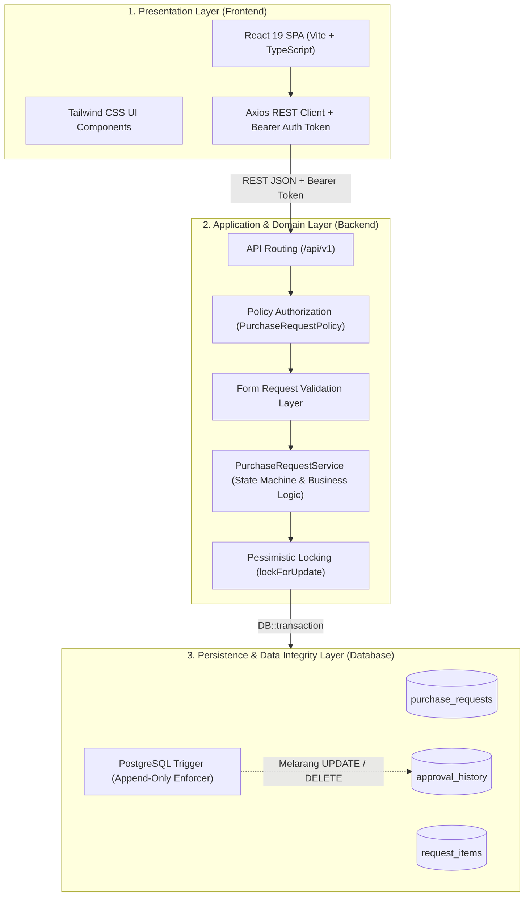
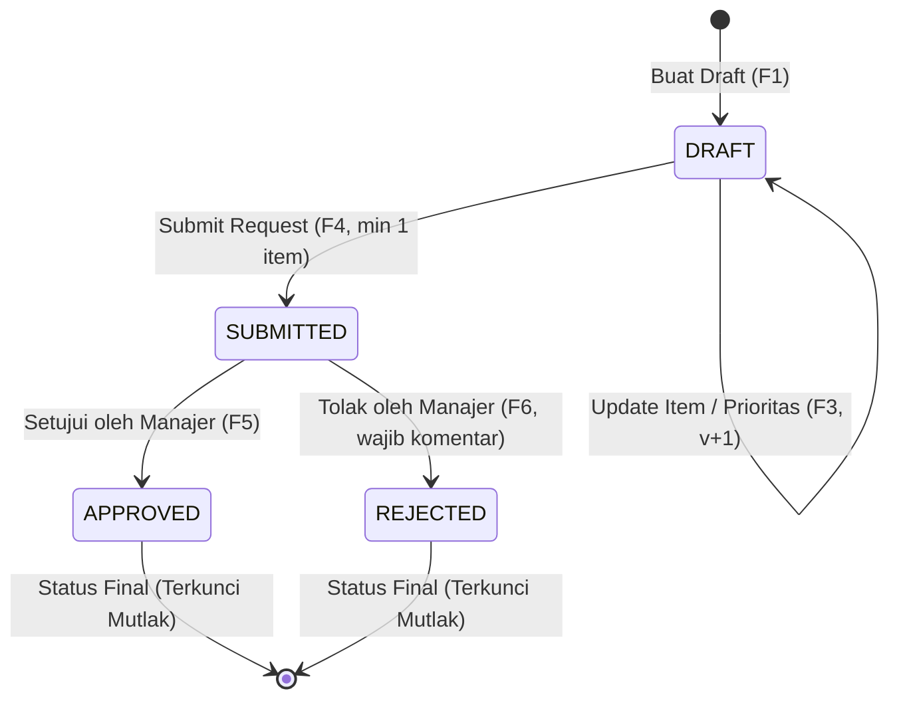

# Architecture Overview & Technical Assumptions

Dokumen ini menjelaskan gambaran arsitektur teknis (*Architecture Overview*) serta asumsi-asumsi teknis (*Technical Assumptions*) yang mendasari perancangan **Sistem Purchase Request Enterprise (TA-PRS)**.

---

## 1. Apa itu "Architecture Overview & Technical Assumptions"?

- **Architecture Overview (Gambaran Arsitektur):**
  Penjelasan komprehensif mengenai struktur teknis sistem, bagaimana komponen-komponen utama (Frontend, Backend, Database) dihubungkan, pembagian layer kode (*separation of concerns*), alur kerja mesin status (*state machine*), serta mekanisme penanganan masalah konkurensi (*race condition*) dan integritas data.
- **Technical Assumptions (Asumsi Teknis):**
  Batasan, kesepakatan, dan prinsip bisnis fundamental yang dijadikan landasan saat merancang logika aplikasi dan skema database, seperti batasan wewenang persetujuan (*segregation of duties*), keterlihatan data per peran, serta proteksi audit trail.

---

## 2. Architecture Overview (Gambaran Arsitektur)

Sistem dirancang dengan arsitektur tiga lapis (*Three-Tier Architecture*) yang memisahkan tanggung jawab secara tegas (*Clean Architecture*):



### 2.1. Penjelasan Komponen Utama

1. **Frontend (React 19 + TypeScript):**
   - Beroperasi sebagai *Single Page Application* (SPA).
   - Seluruh interaksi menggunakan API asynchronous (`api.ts`).
   - Klien tidak memegang kewenangan mutasi data atau kalkulasi finansial — klien hanya bertugas menyajikan antarmuka (*render UI*) dan memvalidasi format input dasar pengguna.
2. **Backend (Laravel 13 & PHP 8.4):**
   - **Form Request Validation:** Menjamin integritas tipe data, batas karakter, bilangan bulat positif untuk Qty, dan nominal harga positif sebelum masuk ke controller.
   - **Policy Layer (`PurchaseRequestPolicy`):** Memisahkan logika otorisasi hak akses berdasarkan role (`EMPLOYEE` vs `MANAGER`) dan kepemilikan data (`isOwner`).
   - **Service Layer (`PurchaseRequestService`):** Mengenkapsulasi seluruh aturan bisnis *state machine*. Tidak ada logika bisnis di Controller.
   - **Kalkulasi Server-Side:** Total harga dihitung ulang secara mutlak oleh server (`qty * unit_price`), melindungi sistem dari manipulasi nilai via DevTools (E4).
3. **Database (PostgreSQL 16):**
   - Menegakkan integritas data pada tingkat terendah melalui *Foreign Key Constraints* dengan `CASCADE ON DELETE`, constraint `CHECK` untuk status dan nilai positif, serta indeks unik pada nomor PR.

---

### 2.2. State Machine Workflow

Status pengajuan dirancang bergerak searah tanpa jalan pintas atau pembalikan status (*no status reversal*):



- **DRAFT:** Status awal. Item, catatan, dan prioritas dapat diubah. Setiap kali draft diperbarui via API `PUT`, nomor versi otomatis naik (`version = version + 1`).
- **SUBMITTED:** Dokumen terkunci dari pengeditan. Siap ditinjau oleh Manajer.
- **APPROVED / REJECTED:** Status final. Tidak dapat diubah kembali ke status mana pun.

---

### 2.3. Penanganan Konkurensi & Race Condition (E5)

Jika dua manajer membuka pengajuan yang sama dan menekan tombol *Approve* / *Reject* di waktu yang hampir bersamaan (*concurrent execution*):

1. Transaksi dibungkus dalam `DB::transaction`.
2. Baris data dikunci di tingkat database menggunakan `lockForUpdate()`:
   ```php
   $lockedRequest = PurchaseRequest::query()
       ->where('id', $request->id)
       ->lockForUpdate()
       ->firstOrFail();
   ```
3. Manajer pertama yang memperoleh *lock* akan memeriksa status (`isSubmitted() == true`), mengubah status menjadi `APPROVED`, mencatat riwayat audit, dan melepaskan lock.
4. Manajer kedua yang menunggu lock akan membaca status terbaru yang sudah `APPROVED`, sehingga validasi `isSubmitted()` gagal dan server melempar `InvalidStateException` (HTTP 409 `INVALID_STATE`).
5. **Hasil:** Tidak akan pernah terjadi *double decision* atau inkonsistensi riwayat audit.

---

### 2.4. Perlindungan Audit Trail Append-Only (Database Trigger)

Untuk menjamin riwayat persetujuan (*approval history*) tidak dapat dimanipulasi bahkan oleh pengguna dengan hak akses database:
- PostgreSQL Trigger `forbid_approval_history_mutation` diaktifkan pada tabel `approval_history`.
- Setiap query `UPDATE` atau `DELETE` langsung pada tabel riwayat audit akan digagalkan oleh trigger:
  ```sql
  CREATE OR REPLACE FUNCTION forbid_approval_history_mutation()
  RETURNS TRIGGER AS $$
  BEGIN
      RAISE EXCEPTION 'approval_history is append-only: UPDATE and DELETE are not allowed';
  END;
  $$ LANGUAGE plpgsql;
  ```

---

## 3. Technical Assumptions (Asumsi Teknis)

Berikut adalah asumsi-asumsi teknis yang disepakati dan diterapkan dalam sistem:

### 1. Segregation of Duties & Pencegahan Self-Approval (E2)
- **Asumsi:** Seorang manajer dapat membuat pengadaan barang untuk kebutuhannya sendiri. Namun, demi tata kelola kepatuhan (*corporate governance*), **manajer dilarang keras menyetujui atau menolak request miliknya sendiri**.
- **Implementasi:** Endpoint approve/reject memverifikasi `$request->requester_id !== $user->id`. Pelanggaran langsung menghasilkan HTTP 403 Forbidden.

### 2. Keterlihatan Data Berbasis Peran (*Role-Based Scoping*, F2)
- **Asumsi:**
  - Karyawan hanya berhak melihat pengajuan yang ia buat sendiri.
  - Manajer bertanggung jawab meninjau pengajuan yang diajukan (`SUBMITTED`), serta memantau pengajuan yang telah diputuskan (`APPROVED`/`REJECTED`). Manajer **tidak boleh melihat pengajuan karyawan lain yang masih berstatus `DRAFT`** karena masih bersifat pribadi dan belum final diajukan.

### 3. Server Sebagai Single Source of Truth Finansial (E4)
- **Asumsi:** Klien web/seluler rentan terhadap manipulasi nilai melalui inspeksi jaringan atau skrip browser.
- **Implementasi:** Nilai `subtotal` dan `total_amount` yang dikirim dari klien diabaikan sepenuhnya. Server menghitung ulang total dari `qty * unit_price` setiap item pada saat penyimpanan.

### 4. Integritas Nilai Moneter
- **Asumsi:** Aplikasi berjalan untuk pengadaan di Indonesia dengan mata uang Rupiah (IDR).
- **Implementasi:** Nilai harga disimpan sebagai `decimal(18,2)` pada database untuk menjamin presisi tinggi tanpa masalah *floating-point binary rounding*.

### 5. Aturan Versi Dokumen (*Document Versioning*)
- **Asumsi:** Nomor versi pengadaan (`v1`, `v2`, dst.) mencerminkan revisi terhadap konten pengadaan.
- **Implementasi:** Nomor versi bertambah (`version + 1`) hanya ketika ada pembaruan isi item, catatan, atau prioritas pada status `DRAFT`. Transisi status (`submit`, `approve`, `reject`) tidak menaikkan nomor versi karena isi barang tidak mengalami perubahan.

### 6. Arsitektur Otentikasi Stateless
- **Asumsi:** Aplikasi dirancang agar siap untuk penskalaan horizontal (*scale-out*).
- **Implementasi:** Menggunakan token Bearer via Laravel Sanctum yang dikirim pada header `Authorization`. Frontend menyimpan token di `localStorage` dan secara otomatis melakukan *auto-logout* jika token kedaluwarsa atau menghasilkan HTTP 401.
