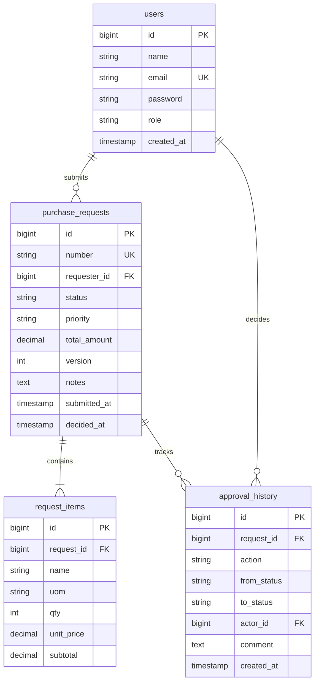
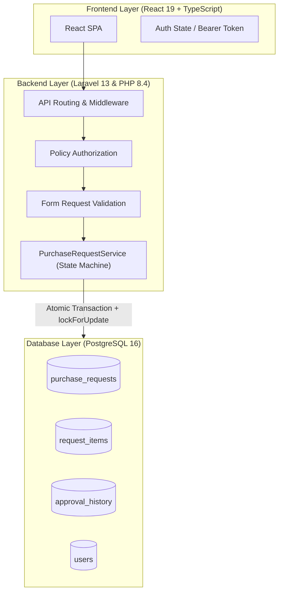
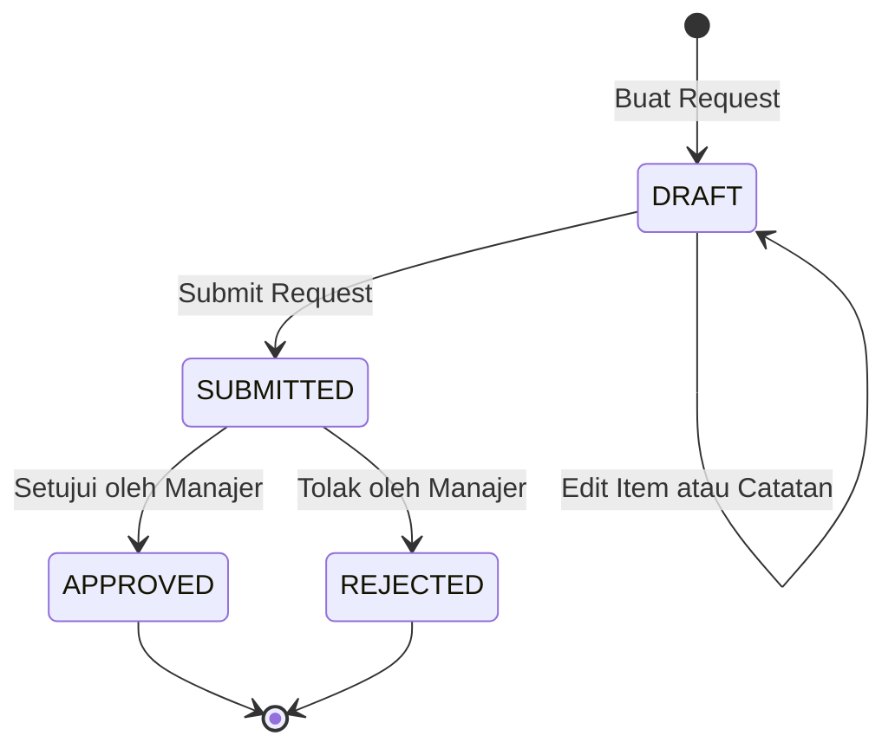

# Sistem Purchase Request Enterprise (TA-PRS)

Aplikasi web manajemen pengadaan barang dan jasa (*Purchase Request* / PR) berbasis multi-peran dengan integritas workflow yang ketat, audit trail terperinci (*append-only*), penanganan *race condition*, dan server sebagai *single source of truth*.

---

## 1. Source Code Repository

- **Repository URL:** [https://github.com/farhantock/nawakara-test.git](https://github.com/farhantock/nawakara-test.git)
- **Branch:** `main`

### Struktur Direktori Repositori

```
purchase-request/
├── app/
│   ├── Enums/                     # Type-safe PHP 8.4 Enums (HistoryAction, RequestPriority, RequestStatus, UserRole)
│   ├── Exceptions/                # Domain-specific exceptions & uniform JSON error handlers
│   ├── Http/
│   │   ├── Controllers/Api/       # RESTful API Controllers (AuthController, PurchaseRequestController)
│   │   └── Requests/              # Form Request validations (StorePurchaseRequestRequest, etc.)
│   ├── Models/                    # Eloquent models (User, PurchaseRequest, RequestItem, ApprovalHistory)
│   ├── Policies/                  # Authorization policies (PurchaseRequestPolicy)
│   └── Services/                  # State Machine & Concurrency Control (PurchaseRequestService)
├── database/
│   ├── migrations/                # Database migrations with CHECK constraints & PostgreSQL triggers
│   └── seeders/                   # DatabaseSeeder (Demo users & initial sample data)
├── resources/
│   ├── css/                       # Tailwind CSS
│   └── js/                        # React 19 Single Page Application (SPA)
│       ├── components/            # UI components (Navbar, RequestList, RequestDetail, SearchableSelect, Modals)
│       ├── constants/             # Centralized constants (uom.ts, priority.ts)
│       ├── types/                 # TypeScript interfaces and domain types
│       └── utils/                 # Formatters (Rupiah, Date, Status & Priority badges)
├── tests/
│   └── Feature/                   # 16 Automated Feature & Unit Tests
├── docker-compose.yaml            # Multi-container orchestration (PostgreSQL 16, API, Web)
├── Dockerfile.api                 # Container build for Laravel PHP 8.4
├── Dockerfile.web                 # Container build for Web frontend
├── API_DOCUMENTATION.md           # Dedicated API Documentation
├── ARCHITECTURE_AND_ASSUMPTIONS.md # Dedicated Architecture & Technical Assumptions
└── README.md                      # Main project documentation
```

---

## 2. README and Setup Instructions

### Opsi A: Menjalankan Menggunakan Docker Compose (Direkomendasikan)

Reviewer dapat menjalankan seluruh sistem (PostgreSQL 16, Laravel API, Web SPA) secara otomatis dalam satu perintah:

```bash
# 1. Masuk ke direktori proyek
cd purchase-request

# 2. Jalankan seluruh container
docker compose up --build -d
```

Setelah container berjalan:
- **Aplikasi Web (React SPA):** [http://localhost:3000](http://localhost:3000) (atau sesuaikan dengan `FORWARD_WEB_PORT` di `.env`)
- **API Endpoint Langsung:** [http://localhost:8000/api/v1](http://localhost:8000/api/v1)
- Database otomatis dimigrasi dan di-seed dengan data pengujian.
- *(Catatan: Port web dapat disesuaikan pada variabel `FORWARD_WEB_PORT` di file `.env`)*

---

### Opsi B: Menjalankan di Lingkungan Lokal (Tanpa Docker)

**Persyaratan Sistem:**
- PHP 8.4 (ekstensi: `pdo_pgsql`, `pgsql`, `mbstring`, `intl`)
- PostgreSQL 16 (Port 5432)
- Composer 2 & Node.js 20+

**Langkah Instalasi:**
```bash
# 1. Install dependencies backend & frontend
composer install
npm install

# 2. Setup environment
cp .env.example .env
php artisan key:generate

# 3. Jalankan migrasi dan seeding database
php artisan migrate:fresh --seed

# 4. Build asset frontend (React Vite)
npm run build

# 5. Jalankan server aplikasi
php artisan serve --port=8000
```

---

### Informasi Akun Pengujian

Demi keamanan dan kepatuhan data (*data confidentiality*), daftar akun pengujian beserta kredensial kata sandi (*credentials*) tidak dicantumkan secara publik di dalam dokumen repositori ini.

Detail akun pengujian (alamat email dan kata sandi untuk peran `EMPLOYEE` dan `MANAGER`) **dikirimkan secara terpisah melalui email submission**.

> *Catatan: Untuk pengujian lokal mandiri di lingkungan dev/docker, akun awal dibuat secara otomatis saat menjalankan seeder bawaan (`php artisan migrate:fresh --seed`).*

---

## 3. Database Schema or Migration

### Skema Relasional (ERD)



### Constraint & PostgreSQL Triggers

1. **CHECK Constraints (Integritas Nilai):**
   - `purchase_requests.status IN ('DRAFT', 'SUBMITTED', 'APPROVED', 'REJECTED')`
   - `purchase_requests.priority IN ('LOW', 'MEDIUM', 'HIGH', 'URGENT')`
   - `request_items.qty > 0`
   - `request_items.unit_price > 0`
2. **PostgreSQL Append-Only Trigger (`approval_history`):**
   Tabel `approval_history` diproteksi oleh fungsi trigger PostgreSQL `forbid_approval_history_mutation`. Setiap perintah `UPDATE` maupun `DELETE` langsung pada tabel riwayat audit akan digagalkan di level database.

---

## 4. API Documentation

Seluruh endpoint beroperasi dengan format JSON pada prefix `/api/v1` dan menggunakan header `Accept: application/json` serta `Authorization: Bearer <token>`.

### Ringkasan Endpoint

| Method | Endpoint | Hak Akses | Deskripsi & Response |
| :--- | :--- | :--- | :--- |
| `POST` | `/api/v1/auth/login` | Publik | Otentikasi pengguna, mengembalikan Bearer Token (`200 OK`) |
| `POST` | `/api/v1/auth/logout` | Authenticated | Mencabut token aktif pengguna (`204 No Content`) |
| `GET` | `/api/v1/auth/me` | Authenticated | Mengambil profil user yang sedang login (`200 OK`) |
| `GET` | `/api/v1/requests` | Authenticated | Menampilkan daftar request terfilter role (`200 OK`) |
| `POST` | `/api/v1/requests` | Karyawan | Membuat draft request baru (`201 Created`) |
| `GET` | `/api/v1/requests/{id}` | Pemilik / Manajer | Mengambil detail PR, items, dan audit history (`200 OK`) |
| `PUT` | `/api/v1/requests/{id}` | Pemilik (Draft) | Memperbarui item, catatan, & prioritas draft (`200 OK`) |
| `POST` | `/api/v1/requests/{id}/submit`| Pemilik (Draft) | Mengajukan request: `DRAFT` ke `SUBMITTED` (`200 OK`) |
| `POST` | `/api/v1/requests/{id}/approve`| Manajer (Non-Pemilik) | Menyetujui request: `SUBMITTED` ke `APPROVED` (`200 OK`) |
| `POST` | `/api/v1/requests/{id}/reject` | Manajer (Non-Pemilik) | Menolak request: `SUBMITTED` ke `REJECTED`, wajib ada alasan (`200 OK`) |
| `GET` | `/api/v1/requests/{id}/history`| Pemilik / Manajer | Mengambil daftar audit trail approval history (`200 OK`) |

### Format Respons Error Seragam

```json
{
  "error": {
    "code": "VALIDATION_FAILED",
    "message": "Validasi gagal",
    "fields": {
      "comment": "Alasan penolakan wajib diisi."
    }
  }
}
```

> *Dokumentasi API lengkap dengan contoh payload dan cURL tersedia pada berkas terpisah: [API_DOCUMENTATION.md](file:///c:/laragon/www/purchase-request/API_DOCUMENTATION.md).*

---

## 5. Minimum 3 Automated Tests (Hasil: 16 Tests Passed)

Sistem dilengkapi dengan **16 automated test cases** yang melindungi seluruh aturan bisnis, alur kerja, otorisasi, dan konkurensi.

### Cara Menjalankan Test Suite

```bash
# Menjalankan di Docker:
docker compose exec api php artisan test

# Menjalankan secara lokal:
php artisan test --env=local
```

### 4 Test Case Kritis Terpilih

| No | Nama Test Case | Aturan Bisnis | Deskripsi Verifikasi |
| :---: | :--- | :--- | :--- |
| 1 | `test_e1_submit_request_without_items_returns_422` | **Integritas (E1)** | Memverifikasi pengajuan tanpa rincian barang ditolak server dengan HTTP 422 dan status tetap Draft. |
| 2 | `test_e2_unauthorized_user_or_self_approving_returns_403_and_status_unchanged` | **Otorisasi (E2)** | Memastikan pemohon yang memiliki role Manajer dilarang menyetujui pengajuannya sendiri (*self-approval prevention*, HTTP 403). |
| 3 | `test_e5_concurrent_manager_approvals_only_one_wins_other_gets_409` | **Konkurensi (E5)** | Mensimulasikan approval paralel oleh 2 manajer via pessimistic row locking (`lockForUpdate`): tepat 1 manajer sukses (200), lainnya ditolak (409). |
| 4 | `test_append_only_direct_update_or_delete_on_approval_history_is_rejected_by_database` | **Keamanan Data** | Membuktikan bahwa trigger PostgreSQL menggagalkan setiap upaya modifikasi langsung pada tabel riwayat audit. |

---

## 6. Brief Architecture Overview and Technical Assumptions

### Arsitektur Tiga Lapis (Three-Tier Architecture)

1. **Frontend Layer:** Single Page Application (SPA) berbasis React 19, TypeScript, dan Tailwind CSS.
2. **Backend Layer:** Laravel 13 running on PHP 8.4 dengan pemisahan logika bisnis di `PurchaseRequestService`.
3. **Database Layer:** PostgreSQL 16 dengan integritas relasional, constraint CHECK, dan Stored Procedure Trigger.

### Diagram Arsitektur



### State Machine Workflow



### Technical Assumptions (Asumsi Teknis)

1. **Segregation of Duties & Pencegahan Self-Approval (E2):** Manajer berhak menyetujui pengadaan karyawan lain, namun **dilarang menyetujui atau menolak request miliknya sendiri**.
2. **Keterlihatan Data Berbasis Peran (F2):** Karyawan hanya melihat request miliknya. Manajer hanya melihat request yang sudah diajukan (`SUBMITTED`, `APPROVED`, `REJECTED`), dan tidak melihat draft karyawan lain.
3. **Server sebagai Single Source of Truth Finansial (E4):** Nilai total dihitung ulang secara mutlak di server dari `qty * unit_price`, mengabaikan segala bentuk manipulasi input total dari sisi klien.
4. **Append-Only Audit Trail:** Catatan riwayat audit persetujuan tidak dapat diubah atau dihapus oleh siapa pun (diproteksi trigger PostgreSQL).
5. **Presisi Finansial:** Menggunakan mata uang Rupiah (IDR) dengan kalkulasi tipe desimal floating-safe di backend.
6. **Aturan Versi Dokumen:** Nomor versi (`version`) hanya bertambah ketika isi barang atau catatan diperbarui pada status `DRAFT`. Aksi transisi status (`submit`, `approve`, `reject`) tidak menaikkan nomor versi.

> *Penjelasan mendalam arsitektur dan analisis teknis tersedia pada berkas terpisah: [ARCHITECTURE_AND_ASSUMPTIONS.md](file:///c:/laragon/www/purchase-request/ARCHITECTURE_AND_ASSUMPTIONS.md).*


### 4 Test Case Kritis Terpilih

| No | Nama Test Case | Aturan Bisnis | Deskripsi Verifikasi |
| :---: | :--- | :--- | :--- |
| 1 | `test_e1_submit_request_without_items_returns_422` | **Integritas (E1)** | Memverifikasi pengajuan tanpa rincian barang ditolak server dengan HTTP 422 dan status tetap Draft. |
| 2 | `test_e2_unauthorized_user_or_self_approving_returns_403_and_status_unchanged` | **Otorisasi (E2)** | Memastikan pemohon yang memiliki role Manajer dilarang menyetujui pengajuannya sendiri (*self-approval prevention*, HTTP 403). |
| 3 | `test_e5_concurrent_manager_approvals_only_one_wins_other_gets_409` | **Konkurensi (E5)** | Mensimulasikan approval paralel oleh 2 manajer via pessimistic row locking (`lockForUpdate`): tepat 1 manajer sukses (200), lainnya ditolak (409). |
| 4 | `test_append_only_direct_update_or_delete_on_approval_history_is_rejected_by_database` | **Keamanan Data** | Membuktikan bahwa trigger PostgreSQL menggagalkan setiap upaya modifikasi langsung pada tabel riwayat audit. |

---

## 6. Brief Architecture Overview and Technical Assumptions

### Arsitektur Tiga Lapis (Three-Tier Architecture)

1. **Frontend Layer:** Single Page Application (SPA) berbasis React 19, TypeScript, dan Tailwind CSS.
2. **Backend Layer:** Laravel 13 running on PHP 8.4 dengan pemisahan logika bisnis di `PurchaseRequestService`.
3. **Database Layer:** PostgreSQL 16 dengan integritas relasional, constraint CHECK, dan Stored Procedure Trigger.

### Diagram Arsitektur


### State Machine Workflow


### Technical Assumptions (Asumsi Teknis)

1. **Segregation of Duties & Pencegahan Self-Approval (E2):** Manajer berhak menyetujui pengadaan karyawan lain, namun **dilarang menyetujui atau menolak request miliknya sendiri**.
2. **Keterlihatan Data Berbasis Peran (F2):** Karyawan hanya melihat request miliknya. Manajer hanya melihat request yang sudah diajukan (`SUBMITTED`, `APPROVED`, `REJECTED`), dan tidak melihat draft karyawan lain.
3. **Server sebagai Single Source of Truth Finansial (E4):** Nilai total dihitung ulang secara mutlak di server dari `qty * unit_price`, mengabaikan segala bentuk manipulasi input total dari sisi klien.
4. **Append-Only Audit Trail:** Catatan riwayat audit persetujuan tidak dapat diubah atau dihapus oleh siapa pun (diproteksi trigger PostgreSQL).
5. **Presisi Finansial:** Menggunakan mata uang Rupiah (IDR) dengan kalkulasi tipe desimal floating-safe di backend.
6. **Aturan Versi Dokumen:** Nomor versi (`version`) hanya bertambah ketika isi barang atau catatan diperbarui pada status `DRAFT`. Aksi transisi status (`submit`, `approve`, `reject`) tidak menaikkan nomor versi.

> *Penjelasan mendalam arsitektur dan analisis teknis tersedia pada berkas terpisah: [ARCHITECTURE_AND_ASSUMPTIONS.md](file:///c:/laragon/www/purchase-request/ARCHITECTURE_AND_ASSUMPTIONS.md).*