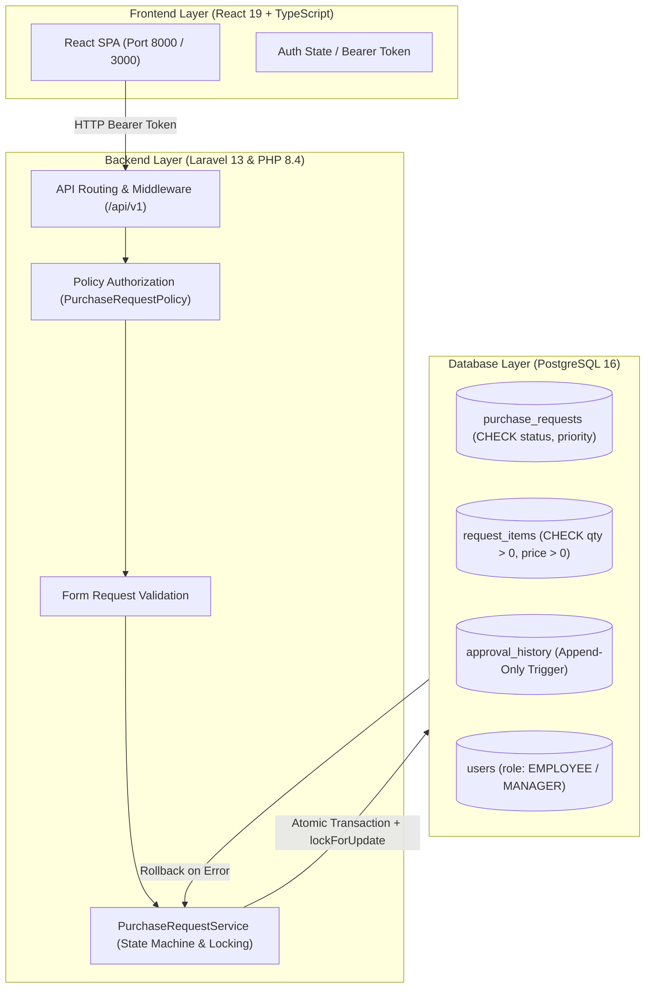
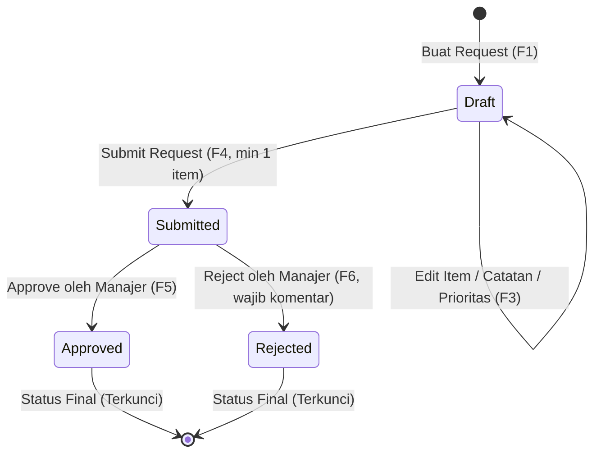
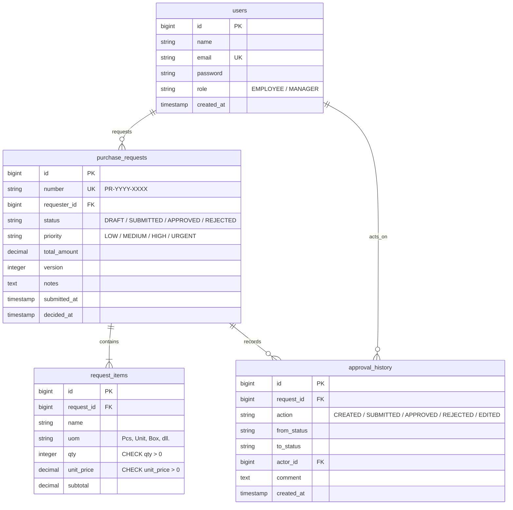

# Sistem Purchase Request Enterprise

Aplikasi web manajemen pengadaan barang dan jasa (*Purchase Request* / PR) berbasis multi-peran dengan integritas workflow yang ketat, audit trail terperinci (*append-only*), penanganan *race condition*, dan server sebagai *single source of truth*.

---

## 2. Architecture Overview & Technical Assumptions

### Arsitektur Tiga Lapis (Three-Tier Architecture)

Sistem ini dirancang dengan pemisahan tanggung jawab yang tegas:
1. **Frontend Layer (Web UI):** Single Page Application (SPA) berbasis React 19, TypeScript, dan Tailwind CSS. Berkomunikasi dengan backend melalui RESTful JSON API menggunakan Bearer Token (Laravel Sanctum). Tidak ada logika bisnis kritis yang dijalankan di sisi klien.
2. **Backend Layer (API Service):** Aplikasi Laravel 13 running on PHP 8.4. Menangani otentikasi, otorisasi berbasis Policy, validasi request, dan state machine workflow di `PurchaseRequestService`.
   - **Atomic State Transitions:** Setiap mutasi dibungkus dalam `DB::transaction`.
   - **Pessimistic Locking:** Menggunakan `lockForUpdate()` untuk mencegah *race condition* atau *double decision* saat manajer melakukan approval paralel (E5).
   - **Server as Single Source of Truth:** Kalkulasi total nilai dihitung ulang secara mutlak di server dari perkalian `qty * unit_price` masing-masing item, mengabaikan segala bentuk manipulasi input nilai total dari klien (E4).
3. **Database Layer (Persistence & Integrity):** PostgreSQL 16 dengan integritas relasional, *foreign key cascade*, constraint CHECK pada level database, dan **PostgreSQL Trigger** untuk memastikan riwayat persetujuan (*approval history*) bersifat *append-only* (tidak dapat diubah atau dihapus bahkan via query langsung).

### Diagram Arsitektur



### State Machine Workflow



### Asumsi Teknis (Technical Assumptions)
1. **Wewenang Manajer & Separation of Duty:** Setiap akun dengan role `MANAGER` berwenang menyetujui atau menolak request yang diajukan oleh karyawan, namun **dilarang keras** menyetujui atau menolak pengajuannya sendiri (*self-approval prevention*, E2).
2. **Keterlihatan Data (Scoping by Role):** Karyawan hanya dapat melihat request miliknya sendiri. Manajer dapat melihat request seluruh karyawan yang berstatus `SUBMITTED`, `APPROVED`, dan `REJECTED`, namun tidak melihat draft milik karyawan lain.
3. **Integritas Moneter:** Kalkulasi finansial diproses dengan pembulatan dua desimal standar per item dan subtotal; nilai total selalu dihitung ulang di server untuk menjamin konsistensi.
4. **Append-Only Audit Trail:** Catatan persetujuan tidak boleh di-update atau di-delete oleh proses apa pun dalam sistem. Integritas ini dilindungi langsung oleh *stored procedure trigger* di level database PostgreSQL.

---

## 3. Database Schema & Migration


### Skema Tabel Utama



### Constraint & Trigger Spesifik
- **Database CHECK Constraint:**
  - `purchase_requests.status IN ('DRAFT', 'SUBMITTED', 'APPROVED', 'REJECTED')`
  - `purchase_requests.priority IN ('LOW', 'MEDIUM', 'HIGH', 'URGENT')`
  - `request_items.qty > 0`
  - `request_items.unit_price > 0`
- **PostgreSQL Append-Only Trigger (`approval_history`):**
  Trigger PostgreSQL `forbid_approval_history_mutation` mencegah perintah `UPDATE` maupun `DELETE` pada tabel riwayat audit, melempar exception `approval_history is append-only`.

---

## 4. Setup Instructions

### Opsi A: Menggunakan Docker Compose (Direkomendasikan)
Menjalankan seluruh sistem (PostgreSQL 16, Laravel API, Web SPA) secara otomatis:

```bash
# 1. Clone repository
git clone <repository-url>
cd purchase-request

# 2. Jalankan seluruh container
docker compose up --build
```

Setelah kontainer siap:
- **Aplikasi Web:** [http://localhost:3000](http://localhost:3000) atau [http://localhost:8000](http://localhost:8000)
- **API Endpoint:** [http://localhost:8000/api/v1](http://localhost:8000/api/v1)
- Database otomatis dimigrasi dan di-seed dengan akun pengujian.

---

## 5. Akun Pengujian
Untuk pengujian lokal mandiri di lingkungan dev/docker, akun awal dibuat secara otomatis saat menjalankan seeder bawaan (`php artisan migrate:fresh --seed`).*

---

## 6. Dokumentasi API (RESTful JSON)

Seluruh request dan response menggunakan header `Accept: application/json` dan `Content-Type: application/json`. Endpoint privat membutuhkan header `Authorization: Bearer <token>`.

### 1. Autentikasi
- **POST `/api/v1/auth/login`**
  - Body: `{ "email": "...", "password": "..." }`
  - Response `200 OK`: `{ "user": { ... }, "token": "..." }`
- **POST `/api/v1/auth/logout`**
  - Response `204 No Content`
- **GET `/api/v1/auth/me`**
  - Response `200 OK`: `{ "user": { "id": 1, "name": "...", "role": "..." } }`

### 2. Purchase Request Endpoints
- **GET `/api/v1/requests`**
  - Query Params opsional: `status=DRAFT|SUBMITTED|APPROVED|REJECTED`, `priority=LOW|MEDIUM|HIGH|URGENT`
  - Response `200 OK`: `{ "data": [ ... ] }`
- **POST `/api/v1/requests`**
  - Body:
    ```json
    {
      "priority": "HIGH",
      "notes": "Pengadaan perangkat kerja baru",
      "items": [
        { "name": "Laptop ThinkPad", "uom": "Unit", "qty": 2, "unit_price": 15000000 }
      ]
    }
    ```
  - Response `201 Created`: `{ "data": { "id": 1, "number": "PR-2026-0001", "status": "DRAFT", ... } }`
- **GET `/api/v1/requests/{id}`**
  - Response `200 OK`: Mengembalikan detail PR, rincian items, dan audit history.
- **PUT `/api/v1/requests/{id}`**
  - Memperbarui request yang berstatus Draft (menaikkan nomor versi PR).
  - Response `200 OK`
- **POST `/api/v1/requests/{id}/submit`**
  - Mengubah status dari `DRAFT` menjadi `SUBMITTED`.
  - Response `200 OK`
- **POST `/api/v1/requests/{id}/approve`**
  - Body (opsional): `{ "comment": "Disetujui untuk dibeli" }`
  - Response `200 OK`
- **POST `/api/v1/requests/{id}/reject`**
  - Body (wajib): `{ "comment": "Anggaran departemen tidak mencukupi" }`
  - Response `200 OK`
- **GET `/api/v1/requests/{id}/history`**
  - Mengambil daftar audit trail lengkap untuk request tersebut.

### Format Standar Error Response
Jika terjadi kesalahan validasi atau pelanggaran aturan bisnis:
```json
{
  "error": {
    "code": "VALIDATION_FAILED",
    "message": "Validasi gagal",
    "fields": {
      "comment": "Alasan penolakan wajib diisi."
    }
  }
}
```

---

## 7. Automated Testing (16 Test Cases)

Seluruh aturan integritas bisnis dilindungi oleh automated feature & unit tests.

### Menjalankan Test Suite
```bash
# Menjalankan di Docker:
docker compose exec api php artisan test

# Menjalankan secara lokal:
php artisan test --env=local
```